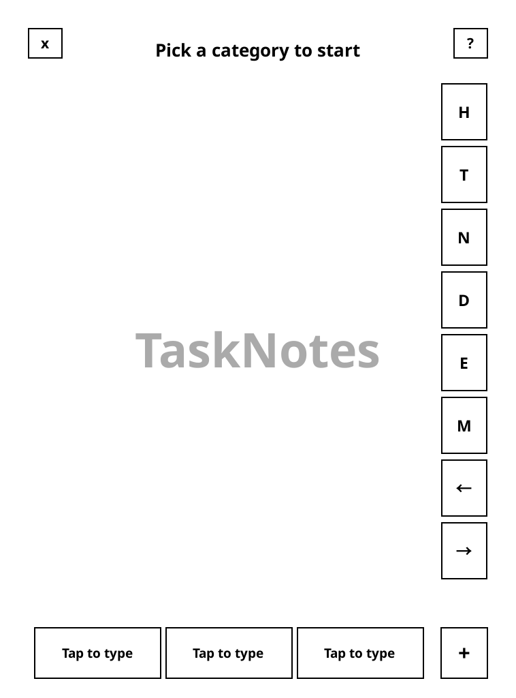
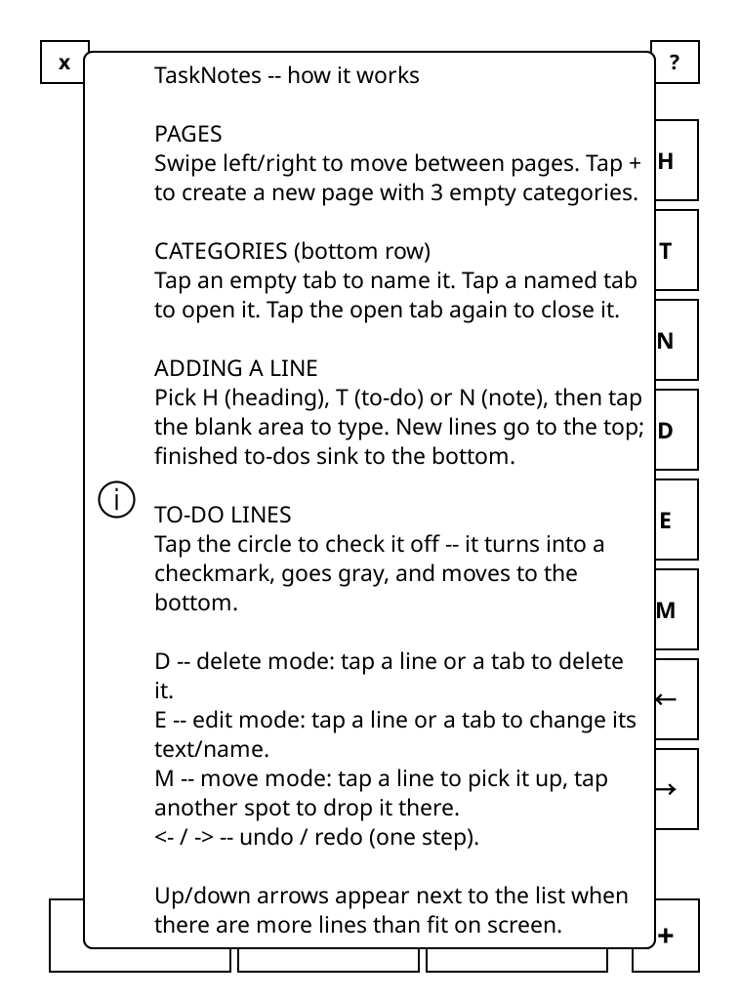

# TaskNotes
TaskNotes is a note-taking plugin for your Kindle running KoReader. You can add Headdings, Task and normal Notes(text).

Hmm.. BUT why on a *Kindle* you might ask.. Phones are addictive, Kindles not. 
With an E-ink display built for books and not connected to your phone, 
it helps you stop getting distracted by unnecessary notifications while writing or creating simple notes/tasks.
____________________________________________________________________
### How to Install, Setup and Locate TaskNotes:
1. Download the .zip file from the latest release.
2. Extract the zip file in to a path your choice.
3. Connect your Kindle to your PC and Exit KoReader*
4. Open KoReader folder from your Kindle Internal Storage
5. Locate the plugins file and open it.
6. Drag the Extracted tasknotes.koplugin into the koplugin folder.
7. Eject your Kindle and boot into KoReader.
8. Swipe from the top and Klick Tools. TaskNotes will be found there.
   (if not found see if there are more than 1 pages in tools if yes
   turn it to the next Page.)

*KoReader doesn't support USB Data Transfer while running yet... :(
  (Exit KoReader and switch into Kindle OS)
_____________________________________________________________________
### HOW TO USE TASKNOTES:

#### Pages 
Swipe left/right to move between pages.
Tap + to create a new page with 3 empty categories.

#### Categories
Tap an empty tab to name it. Tap a named tab to open it. 
Tap the open tab again to close it.

#### Adding a line
Pick H (heading), T (To-Do) or N (note), then tap the blank area to type. 
New lines go to the top. Finished To-Do's sink to the bottom.

#### Adding a To-do line
Tap the circle to check it off. It turns into a checkmark, goes gray, 
and moves to the bottom.

D -- delete mode: tap a line or a tab to delete it.

E -- edit mode: tap a line or a tab to change its text/name.

M -- move mode: tap a line to pick it up, tap another spot to drop it there.

<- / -> -- undo / redo (only one step).

Up/down arrows appear next to the list when there are more lines than fit on screen.
____________________________________________________________________________________
### Images of TaskNotes on a Kindle PW 2 (6th gen)

TaskNotes Layout                                 |  TaskNotes all modes in an overview               | TaskNotes Travel2026 usecase example
:-----------------------------------------------:|:-------------------------------------------------:|-------------------------------------------------:
 |   | 

