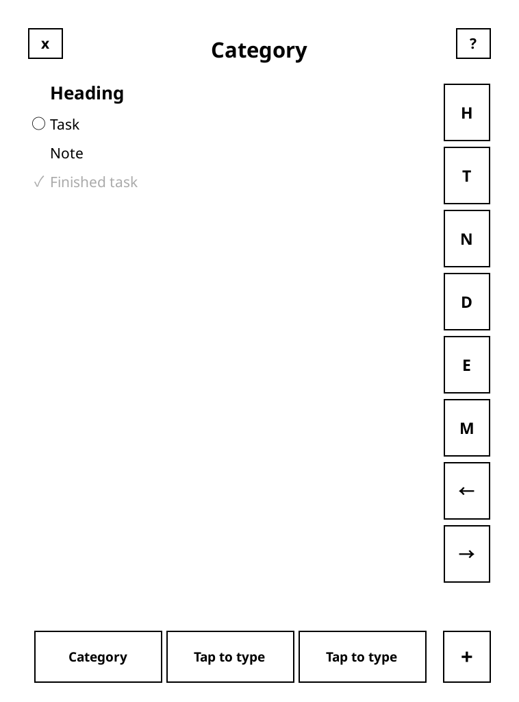
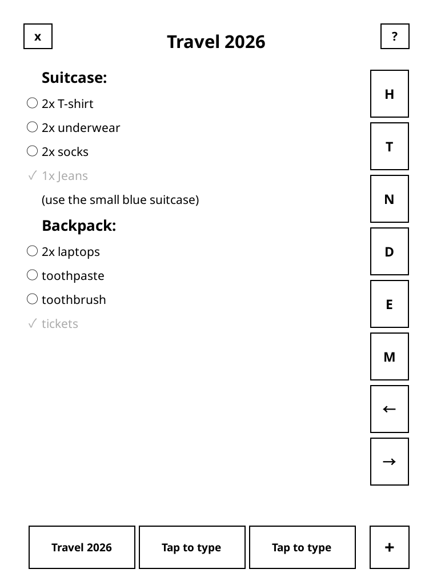

# TaskNotes
TaskNotes is a note-taking plugin for your Kindle running KoReader. You can add Headings, Task and normal Notes (text).

Hmm.. BUT why on a *Kindle* you might ask.. Phones are addictive, Kindles not. 
With an E-ink display built for books and not connected to your phone, 
it helps you stop getting distracted by unnecessary notifications while writing or creating simple notes/tasks.
____________________________________________________________________
### <ins>How to Install, Setup and Locate TaskNotes:</ins>
1. Download the .zip file from the latest release.
2. Extract the zip file into a folder of your choice.
3. Connect your Kindle to your PC and Exit KoReader*
4. Open the "koreader" folder from your Kindle's Internal Storage.
5. Locate the "plugins" folder and open it.
6. Drag the extracted "tasknotes.koplugin" into the plugins folder.
7. Eject your Kindle and boot into KoReader.
8. Swipe from the top and tap Tools. TaskNotes will be found there. 
   (Not found? There might be more than one page. Switch to the next page.)

>*KOReader doesn't support USB data transfer while it's running yet... :( 
 &nbsp;&nbsp;(Exit KoReader and switch into Kindle OS)
_____________________________________________________________________
### <ins>How to use TaskNotes</ins>

**Pages**  
Swipe left/right to move between pages.
Tap + to create a new page with 3 empty categories.

**Categories** 
Tap an empty tab to name it. Tap a named tab to open it. 
Tap the open tab again to close it.

**Adding a line** 
Pick H (heading), T (To-Do's) or N (note), then tap the blank area to type. 
New lines go to the top. Finished To-Do's sink to the bottom.

**Adding a To-do line** 
Tap the circle to check it off. It turns into a checkmark, goes gray, 
and moves to the bottom.

D -- delete mode: tap a line or a tab to delete it. 
E -- edit mode: tap a line or a tab to change its text/name. 
M -- move mode: tap a line to pick it up, tap another spot to drop it there. 
<- / -> -- undo / redo (only one step). 

Up/down arrows appear next to the list when there are more lines than fit on screen.
____________________________________________________________________________________
### TaskNotes Screenshots
***(Taken on a Kindle PW 2 (6th Gen))**
 Layout                                |  Modes Overview                                             | Example: Packing List
:-------------------------------------:|:-----------------------------------------------------------:|:-----------------------------------------------------------------:
 |   |  
